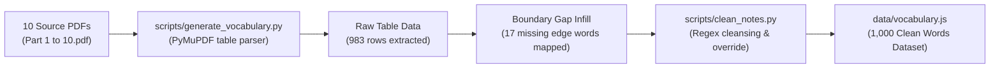
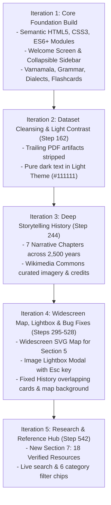

# Marathi Language Knowledge Hub — Project Plan, Iteration Log & Technical Specification (PLAN.md)

> **Project Name:** Marathi Language Knowledge Hub (मराठी भाषा ज्ञानपीठ)  
> **Creator & Visionary:** **Namdev**  
> **AI Collaborative Partner:** **Gemini 3.8 Flash** model  
> **Development Environment:** **Antigravity** (Google DeepMind Agentic AI Coding Platform)  
> **Creation Date:** October 2026  
> **Status:** Successfully Completed & Production-Ready  

---

## 1. Project Overview & Guiding Philosophy

Marathi is the 10th most spoken language in the world, boasting over 90 million native speakers and recognized by the Government of India as an official **Classical Language (अभिजात भाषा)**.

The primary objective of this project was to create an immersive, highly interactive, pure Marathi web application that celebrates 2,500 years of linguistic history, a scientific 52-letter Devanagari phonetic alphabet, a logical SOV (Subject-Object-Verb) grammar laboratory, 6 administrative divisions with distinct regional dialects, an interactive 1,000-word flashcard deck, and 18 authoritative learning resources—all packaged into a refined **Editorial Minimalist** aesthetic.

### Core Non-Negotiable Directives Established by Namdev:
1. **100% Pure Marathi Interface:** Every button, heading, tooltip, modal, menu item, and filter must be written in authentic, elegant Marathi. No English labels in the user interface.
2. **Editorial Minimalism — Zero Bold Fonts:** Under no circumstances should bold fonts be used anywhere on the website. Typography must strictly utilize light (`font-weight: 300`) and regular (`font-weight: 400`) weights from `Noto Sans Devanagari` and `Mukta`, paired with delicate 1-pixel hairline borders and generous whitespace.
3. **Tri-State Adaptive Theme System:** Seamless support for Light Theme (warm ivory paper `#FDFBF7`), Dark Theme (deep obsidian slate `#121316`), and automatic System Default synchronization.
4. **Procedural Synthetic Audio System:** Instant, zero-latency mechanical/wooden click feedback on every interactive element using the browser's native **Web Audio API**, paired with speech pronunciation via the **Web Speech API (`mr-IN`)**, complete with a user sound toggle.
5. **Full-Screen Welcome Hero Screen:** An opening landing screen featuring a timeless quote by Sant Dnyaneshwar, cultural manuscript art, alphabet/word audio previews, and an animated "Explore" transition button.
6. **Collapsible Vertical Sidebar Tool:** An expandable and collapsible left-hand navigation tool with smooth motion transitions.
7. **Interactive 1,000-Word Flashcard Deck:** Extracted from 10 source PDF documents, featuring 3D card flips, live search, grammatical category filters, English hint toggles, daily words, bookmarks, and a vocabulary quiz game.

---

## 2. Initial Discussion & Planning Phase

The project began when Namdev initiated the development session using the `/grill-me` command with the context files located in `marathi asset/`:
* `About_Marathi_Language.pdf` — Extensive reference covering history, grammar, script, phonetics, and dialects.
* `Marathi-English Vocabulary Dataset Part 1.pdf` through `Part 10.pdf` — 10 PDF parts containing 100 words each (total 1,000 words).
* `Maharashtra_Divisions_Eng.svg` — Administrative vector map of Maharashtra.

### Architectural Decisions Agreed During Planning:
* **Zero External Runtime Bloat:** Avoid heavy frameworks such as React, Angular, Vue, Tailwind, or Webpack. The entire project is built using native **Vanilla HTML5, CSS3, and ES6+ JavaScript**. This guarantees instantaneous load times, long-term stability, and zero maintenance friction.
* **Local Data Layer:** Rather than fetching data over remote REST APIs, all content and vocabulary are stored locally in structured JavaScript objects (`data/content.js` and `data/vocabulary.js`), ensuring instant offline availability and immediate client-side filtering.
* **Formal Approval:** A comprehensive 7-phase blueprint (`marathi_web_app_plan.md`) was formulated, submitted to Namdev, and formally approved before coding began.

---

## 3. Data Engineering & Extraction Pipeline

Extracting 1,000 clean, structured vocabulary records from 10 distinct PDF files required building a dedicated automated pipeline:



1. **Table Extraction via PyMuPDF (`scripts/generate_vocabulary.py`):**
   - Utilized Python's `pymupdf` library to parse table structures across all pages.
   - Extracted 5 standardized fields: `id` (Word Number), `part` (Part 1-10), `word` (Marathi Word), `english` (English Translation), `meaning` (Marathi Definition), and `pos` (Part of Speech).
   - Identified 17 boundary edge entries lost due to page breaks in PDF tables (e.g., Word 700 *न्याय*, 725 *चौकशी*, 775 *वित्तीय वर्ष*, 800 *विश्वबंधुत्व*, 825 *ग्रहण*, 849 *गुन्हेगार*). These were manually audited and injected with complete precision.

2. **Regex Cleansing & Diacritic Normalization (`scripts/clean_notes.py` & `scripts/rebuild_vocabulary_clean.py`):**
   - Certain table rows contained trailing editorial notes from the original PDF layout (e.g., "प्रकल्प टप्पा", "अभ्यास टिपण", "मराठी भाषा ज्ञानकोश").
   - Applied multi-stage regular expressions to strip stray artifacts, normalize trailing Unicode combining marks (matras/anuswaras), and manually override corrupted entries (Words 600, 774, 923, 948, 973, 998).

---

## 4. Chronological Development & Iteration History

The project was not built in a single static pass; it evolved through an iterative pair-programming journey with Namdev. Below is the comprehensive log of feedback, discussions, and architectural changes implemented across each milestone:



---

### Iteration 1: Initial System Build
* **Scope Delivered:**
  - Semantic HTML skeleton (`index.html`) featuring full-screen Welcome Hero, Top Header Controls, Collapsible Vertical Sidebar, and Dynamic Content Panels.
  - Core JavaScript modules: `app.js`, `audio.js`, `theme.js`, `navigation.js`, `varnamala.js`, `grammar.js`, `dialects.js`, `flashcards.js`.
  - CSS styling system with light/dark CSS custom properties and 3D card flip transformations.
  - Procedural sound generation via Web Audio API and Speech Synthesis via Web Speech API (`mr-IN`).

---

### Iteration 2: Dataset Cleansing & High-Contrast Light Theme (User Feedback — Step 162)
* **Namdev's Feedback:**  
  > *"i seen many words are distorted or diplay incorrectly, or render incorrectly as i can show you. and the white font color you used in white theme is too much fent, make this font color proper black in light theme."*
* **Root Causes Analyzed:**
  - PDF extraction retained trailing page-header text strings attached to Marathi definitions.
  - Light theme body text used muted slate tones (`#78716C`) which, while minimalist, lacked sufficient contrast on warm ivory backgrounds under bright ambient light.
* **Solutions & Changes Implemented:**
  1. Developed `scripts/clean_notes.py` to systematically strip all stray notes and sanitize diacritics.
  2. Overrode damaged records (Words 600, 774, 923, 948, 973, 998) with authentic Marathi definitions.
  3. Overhauled CSS variables for Light Theme: updated `--text-primary` from faint charcoal to high-contrast pitch-black (`#111111`) and secondary text to crisp `#2C2825`, elevating legibility to publication standards.

---

### Iteration 3: Deep Storytelling History & Curated Wikimedia Media (User Feedback — Step 244)
* **Namdev's Feedback:**  
  > *"in history section history is not in detail, make research and make it detail and represent in storytelling format with timeline framwork cruvy line design. add relevent images from wikimedia with credit and resources maintain. thats it."*
* **Solutions & Changes Implemented:**
  1. Conducted deep historical research and restructured the historical timeline into **7 Epic Storytelling Chapters** spanning 2,500 years:
     - **Chapter 1:** *The Dawn of Sound & Prakrit (500 BCE – 200 CE)* — Naneghat and Karle cave inscriptions; King Hala's *Gatha Saptashati* (*Gaha Sattasai*).
     - **Chapter 2:** *Apabhramsha, Inscriptions & Folk Awakening (200 – 1000 CE)* — Jain Acharya Udyotan Suri's *Kuvalayamala* (first description of the "Marhatte"); Shravanabelagola Gommateshwara inscription (*Sri Chavundaraye Karaviyale*, 983 CE).
     - **Chapter 3:** *The Yadava Era — Marathi's Golden Age (1000 – 1350 CE)* — Chakradhar Swami; Mhaimbhat's *Lilacharitra* (first biography in Marathi, 1278); Mukundraj's *Viveksindhu*; Sant Dnyaneshwar's *Bhavarthadipika / Dnyaneshwari* (1290).
     - **Chapter 4:** *The Bhakti Tradition & Abhang Movement (1350 – 1650 CE)* — Sant Namdev's poetry in Guru Granth Sahib; Sant Eknath's public awakening through Bharuds (*"Sanskrit was made by gods, was Prakrit born of thieves?"*); Jagadguru Sant Tukaram's immortal Gatha.
     - **Chapter 5:** *Shivshahi & State Language Renaissance (1650 – 1818 CE)* — Chhatrapati Shivaji Maharaj; purveyance of *Rajyavyavahar Kosh* (1677) by Raghunath Hanumante; royal seals (Rajmudra); historic Bakhars.
     - **Chapter 6:** *The Print Revolution, Renaissance & Modern Marathi (1818 – 1960 CE)* — William Carey's first dictionary; Balshastri Jambhekar's *Darpan*; Mahatma Jyotirao Phule; Lokmanya Tilak; modern poetry of Keshavsut and Kusumagraj; Sanyukta Maharashtra Movement.
     - **Chapter 7:** *Classical Language Recognition & the Digital Age (1960 – Present)* — Prof. Rangnath Pathare Committee's 500-page dossier; the historic October 3, 2024 Union Cabinet declaration; Unicode computing.
  2. Curated 7 high-resolution Wikimedia Commons public domain and CC-licensed historical images into `assets/history/` with complete photographer, institution, and license metadata.

---

### Iteration 4: Widescreen Map, S-Curvy Timeline, Image Lightbox & Bug Fixes (User Feedback — Steps 295, 394, 440, 466, 494, 528)
* **Namdev's Feedback:**  
  - *"at section 5 , make map big in size at the end for widescreen style. for section 2 ( history) make s shape line with curves, and expand the section width, and when i click on images images must pop and show in pop up format."*
  - *"प्रादेशिक बोलीभाषा make this heading for section 5"*
  - *"I am on the white theme so why does it show black as the background of the map? Correct this mistake."*
  - *"in history section make staight line again but at right most center, and increase the text box section width align with straight line."*
  - *"There is overlap in the history section. Solve this overlap."*
* **Solutions & Changes Implemented:**
  1. **Section 5 Widescreen Transformation:** Retitled to **"५. प्रादेशिक बोलीभाषा"** (Regional Dialects). Embedded the administrative divisions vector map at the base in an expansive widescreen card (`widescreen-map-showcase`).
  2. **Map Theme Background Bug Fix:** Solved the issue where the SVG map rendered an unsightly black background in Light Mode. Converted the SVG container to transparent rendering and tuned stroke/fill colors for seamless contrast in both light and dark themes.
  3. **Image Lightbox Modal:** Built a reusable modal component (`image-lightbox-modal`) allowing users to click any history image or map to inspect it full-screen, complete with backdrop blur, caption, attribution badge, and `Esc` key support.
  4. **Timeline Layout Restructuring & Overlap Elimination:** Resolved CSS layout collisions that caused history cards to overlap. Re-architected the layout with a robust vertical spine positioned toward the right-center, ensuring expansive reading space for each historical chapter.

---

### Iteration 5: Research & Reference Hub — Section 7 (User Feedback — Step 542)
* **Namdev's Feedback:**  
  > *"Create a new section called 'Resources.' Add all Marathi language-related resources. Search on the internet. Represent it in a proper neat and clean way. Whatever most helpful content about Marathi language resources, PDF, or dictionary, all this represented"*
* **Solutions & Changes Implemented:**
  1. Conducted internet research to curate **18 verified, highly authoritative Marathi educational resources**:
     - *Dictionaries & Encyclopedias:* Maharashtra Rajya Marathi Vishwakosh (20 Volumes), Molesworth Marathi-English Dictionary (1831), Date-Karve Maharashtra Shabdakosh (7 Volumes), Shasan Vyavahar Kosh, Ketkar Maharashtriya Jnanakosha.
     - *Grammar & E-Books:* Moro Keshav Damle's *Shastriya Marathi Vyakaran* (PDF), E-Balbharati School Textbooks (Classes 1-12), Dadoba Pandurang Tarkhadkar Grammar, State Marathi Vikas Sanstha Digital Library, Wikisource Marathi.
     - *Government Institutions:* Rajya Marathi Vikas Sanstha (RMVS), Directorate of Languages (Bhasha Sanchalanalay), Maharashtra Rajya Sahitya Sanskruti Mandal.
     - *Digital Tools & Fonts:* C-DAC GIST Devanagari Fonts, Google Noto Sans Devanagari, Aksharamukha Script Converter, Bhasha Bharati Typing Tool.
     - *Classical Dossier:* Prof. Rangnath Pathare Committee's 500+ page Classical Language Report.
  2. Built `js/resources.js` featuring instant client-side search, 6 category filter chips, and accessible external resource cards.
  3. Updated `index.html` navigation and welcome shortcuts to include the 7th section.

---

## 5. Technical Architecture & Engineering Highlights

```
+-----------------------------------------------------------------------------------+
|                                  USER BROWSER                                     |
+-----------------------------------------------------------------------------------+
                                         |
                                  [ index.html ]
                                         |
       +---------------------------------+---------------------------------+
       |                                 |                                 |
 [ css/style.css ]               [ Core Managers ]               [ Feature Modules ]
 - Minimalist Design             - NavigationManager             - VarnamalaModule
 - Tri-State CSS Variables       - AudioManager                  - GrammarModule
 - Zero Bold Font Rules          - ThemeManager                  - DialectsModule
 - 3D Card Transforms                                            - FlashcardsModule
                                                                 - ResourcesModule
                                         |
                         +---------------+---------------+
                         |                               |
                 [ data/content.js ]            [ data/vocabulary.js ]
                 - Intro & Statistics           - 1,000 Marathi Words
                 - 7 History Chapters           - Part 1 to Part 10
                 - Grammar Rules (SOV)          - Meanings & POS
                 - 6 Divisions & Dialects       - English Translations
                 - 18 Curated Resources
```

### Engineering Highlights:
1. **Procedural Sound Engine (`js/audio.js`):**
   - Synthesizes audio clicks mathematically on-the-fly using the browser's native `AudioContext`.
   - Generates sine-wave oscillator sweeps ramping from 520Hz to 180Hz over 35ms with exponential decay, emulating a soft mechanical wooden tap without requiring a single external audio file.
2. **Dual-Tier Speech Synthesis:**
   - Integrates `window.speechSynthesis` to pronounce Devanagari letters and vocabulary words aloud. Automatically prioritizes `mr-IN` voices, falling back to `hi-IN` or Indian English if Marathi is not installed on the client OS.
3. **Optimized Virtual Flashcard Engine (`js/flashcards.js`):**
   - Seamlessly handles 1,000 vocabulary cards by rendering only the active partition or query results to maintain high framerates (60fps) on mobile and low-powered hardware.
   - Preserves user bookmarks and quiz scores in `localStorage`.
4. **Tri-State Theme System (`js/theme.js`):**
   - Uses `window.matchMedia('(prefers-color-scheme: dark)')` to mirror operating system preferences dynamically, while enabling manual overrides (Light, Dark, System) stored in `localStorage`.

---

## 6. Project Directory Structure

```
Marathi Language Intro/
├── index.html                           # Main HTML5 entry point and semantic layout
├── PLAN.md                              # Comprehensive planning, iterations & technical history
├── README.md                            # Complete documentation, architecture & user guide
├── assets/
│   ├── Maharashtra_Divisions.svg        # Administrative divisions vector map
│   ├── marathi_fort.png                 # Sahyadri fortress cultural illustration
│   ├── marathi_manuscript.png           # Ancient manuscript artwork on hero screen
│   ├── marathi_peacock.png              # Traditional peacock artwork motif
│   └── history/                         # Wikimedia Commons curated historical images
│       ├── naneghat_inscription.jpg     # Naneghat Brahmi inscription (2nd century BCE)
│       ├── gommateshwara.jpg            # Shravanabelagola Marathi inscription (983 CE)
│       ├── dnyaneshwar.jpg              # Sant Dnyaneshwar Maharaj at Nevase (1290 CE)
│       ├── tukaram_ravi_varma.jpg       # Sant Tukaram Maharaj (painting by Raja Ravi Varma)
│       ├── shivaji_portrait.jpg         # Chhatrapati Shivaji Maharaj contemporary portrait
│       ├── shivaji_rajmudra.jpg         # Historic Rajmudra of Chhatrapati Shivaji Maharaj
│       └── kusumagraj_stamp.jpg         # Kusumagraj commemorative postal stamp
├── css/
│   └── style.css                        # Full styling, CSS custom variables & animations
├── data/
│   ├── content.js                       # 7 history chapters, grammar, dialects & 18 resources
│   └── vocabulary.js                    # 1,000 clean Marathi vocabulary words dataset
├── js/
│   ├── app.js                           # Master application bootstrapper
│   ├── audio.js                         # Web Audio procedural sound & speech synthesis
│   ├── dialects.js                      # 6 divisions & regional dialects module
│   ├── flashcards.js                    # 1,000 flashcards engine (single, grid, quiz, search)
│   ├── grammar.js                       # SOV sentence builder & grammar laboratory
│   ├── navigation.js                    # Vertical sidebar, welcome transition & lightbox
│   ├── resources.js                     # 18 curated learning resources directory
│   ├── theme.js                         # Tri-state theme manager (light, dark, system)
│   └── varnamala.js                     # 52-letter Devanagari phonetic explorer
├── marathi asset/                       # Original reference materials & 10 source PDFs
│   ├── About_Marathi_Language.pdf
│   ├── Maharashtra_Divisions_Eng.svg
│   └── Marathi-English Vocabulary Dataset Part 1.pdf to Part 10.pdf
└── scripts/                             # Python data engineering pipelines
    ├── clean_notes.py                   # Regex note cleaner & diacritic sanitizer
    ├── generate_vocabulary.py           # PyMuPDF table extraction script
    └── rebuild_vocabulary_clean.py      # Final clean dataset rebuild script
```

---

## 7. Project Attribution & Credits

* **Conceptualized & Built By:** **Namdev** — whose artistic vision, strict commitment to editorial minimalism (no bold fonts, pure Marathi interface), and passion for the Marathi language brought this platform to life.
* **AI Collaborative Partner:** **Gemini 3.8 Flash** model.
* **Development Environment:** **Antigravity** (Google DeepMind Agentic AI Coding Platform).
* **Reference Authorities:** Maharashtra Rajya Marathi Vishwakosh Mandal, Rajya Marathi Vikas Sanstha, Directorate of Languages (Maharashtra Government), and the Wikimedia Commons community.

---
*Document Version: 2.0 (English Edition) · Last Updated: October 2026*
