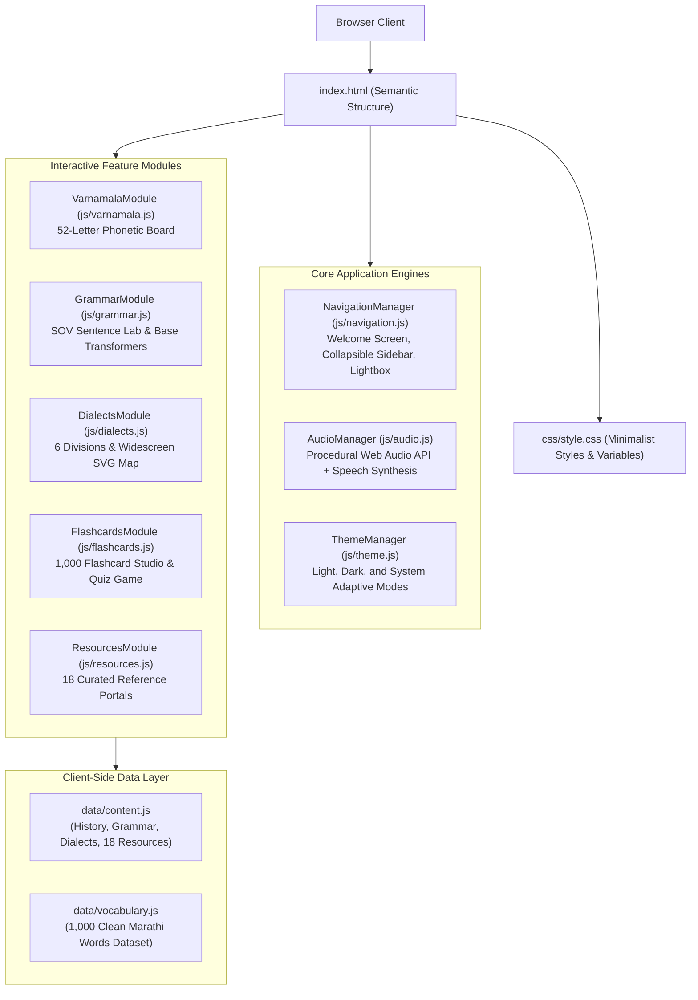

# 🪶 Marathi Language Knowledge Hub (मराठी भाषा ज्ञानपीठ)

> **Classical Language of India · अभिजात भाषा गौरव**  
> An immersive, highly interactive, pure Marathi web application celebrating 2,500 years of linguistic history, a 52-letter scientific phonetic alphabet, a logical grammar laboratory, 6 regional dialects, an interactive 1,000-word flashcard deck, and an authoritative directory of 18 educational resources.

---

## 📌 Project Highlights & Executive Summary

* **Creator & Visionary:** **Namdev**
* **AI Collaborative Partner:** **Gemini 3.8 Flash** model
* **Development Environment:** **Antigravity** (Google DeepMind Agentic AI Coding Platform)
* **Tech Stack:** Vanilla HTML5, CSS3, ES6+ JavaScript, Web Audio API, Web Speech API
* **Dependencies:** **Zero External Frameworks / Zero Bloat** — built without React, Angular, Vue, Tailwind, or Webpack for instantaneous loading and long-term stability.
* **UI Language:** **100% Pure Marathi** (All menus, buttons, cards, tooltips, and search boxes).
* **Design Philosophy:** **Editorial Minimalism** — strictly **NO BOLD FONTS** anywhere on the website. Crafted with delicate light (`font-weight: 300`) and regular (`font-weight: 400`) weights, warm paper/obsidian palettes, and hairline 1-pixel borders.

---

## 📑 Table of Contents

1. [Design Philosophy & Aesthetics](#1-design-philosophy--aesthetics)
2. [Application Architecture & Tech Stack](#2-application-architecture--tech-stack)
3. [How the Application Works (Core Logic & Lifecycle)](#3-how-the-application-works-core-logic--lifecycle)
4. [Detailed Feature Walkthrough](#4-detailed-feature-walkthrough)
   - [Welcome Hero Screen](#welcome-hero-screen)
   - [1. Language Overview (भाषा परिचय)](#1-language-overview-भाषा-परिचय)
   - [2. History & Linguistic Timeline (इतिहास व उगम)](#2-history--linguistic-timeline-इतिहास-व-उगम)
   - [3. Phonetic Varnamala Explorer (वर्णमाला दालन)](#3-phonetic-varnamala-explorer-वर्णमाला-दालन)
   - [4. Interactive Grammar Laboratory (व्याकरण प्रयोगशाळा)](#4-interactive-grammar-laboratory-व्याकरण-प्रयोगशाळा)
   - [5. Regional Dialects & Widescreen Map (प्रादेशिक बोलीभाषा व नकाशा)](#5-regional-dialects--widescreen-map-प्रादेशिक-बोलीभाषा-व-नकाशा)
   - [6. 1,000 Vocabulary Flashcards Studio (१०६० शब्दसंग्रह फ्लॅशकार्ड्स)](#6-1000-vocabulary-flashcards-studio-१०००-शब्दसंग्रह-फ्लॅशकार्ड्स)
   - [7. Research & Resources Hub (अभ्यास संसाधने व संदर्भ दालन)](#7-research--resources-hub-अभ्यास-संसाधने-व-संदर्भ-दालन)
5. [Procedural Audio Engine & Speech Synthesis](#5-procedural-audio-engine--speech-synthesis)
6. [Tri-State Theme System](#6-tri-state-theme-system)
7. [Project Directory Structure](#7-project-directory-structure)
8. [How to Run and Use](#8-how-to-run-and-use)
9. [Project Credits & Attributions](#9-project-credits--attributions)

---

## 1. Design Philosophy & Aesthetics

The Marathi Language Knowledge Hub breaks away from noisy, generic UI trends by adopting the timeless elegance of classic editorial typography and traditional manuscript aesthetics:

* **Strict "Zero Bold Fonts" Rule:**  
  Per Namdev's core directive, no element on the website uses bold or extra-bold fonts (`font-weight: 600`, `700`, or `800`). All headings, buttons, body copy, and badges exclusively employ `font-weight: 300` (Light) and `font-weight: 400` (Regular) from Google Fonts' `Noto Sans Devanagari` and `Mukta`.
* **Editorial Color Palette:**
  * **Light Theme (Warm Ivory Paper):** Warm parchment white background (`#FDFBF7`), pure white card surfaces (`#FFFFFF`), and pitch-black high-contrast text (`#111111`) for crisp, publication-grade reading.
  * **Dark Theme (Deep Obsidian Slate):** Charcoal-obsidian background (`#121316`), deep ash panels (`#1A1C20`), and soft warm off-white text (`#EDEDF0`) that prevents eye fatigue.
  * **Terracotta Accent:** Traditional saffron-earth tone (`#C25E2E` in light mode, `#E07A4F` in dark mode) used sparingly for delicate 1-pixel rules, tags, and focal points.
* **Cultural Visual Motifs:**  
  Authentic historical artwork including ancient palm-leaf manuscripts, Sahyadri hill-forts, and the traditional Maharashtra peacock motif.

---

## 2. Application Architecture & Tech Stack



### Technical Specification Table:
| Component | Technology | Purpose & Implementation |
| :--- | :--- | :--- |
| **Markup & Semantics** | HTML5 Semantic Elements | Semantic landmarks (`article`, `section`, `nav`, `header`, `main`) ensuring native accessibility |
| **Styling & Layout** | CSS3 Grid, Flexbox, Custom Properties | Dynamic theme switching, 3D card perspective flips, hairline borders, zero bold styles |
| **Typography** | Google Web Fonts | `Noto Sans Devanagari` and `Mukta` loaded with 300 and 400 weights only |
| **Application Logic** | Vanilla JavaScript (ES6+ Classes) | Modular, decoupled classes without external state libraries or bundlers |
| **Procedural Audio** | Web Audio API | Zero-latency, mathematically synthesized acoustic clicks and wooden card flips |
| **Speech Pronunciation**| Web Speech API (`SpeechSynthesis`) | Native Devanagari speech output targeting `mr-IN` voice with fallbacks |
| **State Persistence** | `localStorage` & `sessionStorage` | Remembers theme preference, audio state, bookmarks, quiz scores, and sidebar state |

---

## 3. How the Application Works (Core Logic & Lifecycle)

### 1. Initialization Sequence (`js/app.js`):
1. The browser fires the `DOMContentLoaded` event.
2. `NavigationManager.init()` executes:
   - Evaluates `sessionStorage.getItem('marathi_explored')`. If the user is visiting for the first time in the current session, the full-screen **Welcome Hero Screen** (`#welcome-hero-screen`) is presented.
   - If previously explored, the welcome screen is bypassed automatically to resume the main workspace directly.
3. `ThemeManager.init()` resolves the stored theme mode (`system`, `light`, or `dark`) and configures `data-theme` attributes on the root `<html>` element.
4. `AudioManager.init()` registers a lazy single-gesture listener (`click` or `keydown`) to initialize and resume the browser's `AudioContext` without triggering autoplay restrictions.
5. The default active section (`intro`) is loaded and its corresponding module's `render()` method is called dynamically.

### 2. Collapsible Navigation Sidebar Logic:
* The left-hand navigation sidebar features a toggle button to expand or collapse between a full-text menu and an icon-only minimal rail.
* The expanded/collapsed state is synchronized with `localStorage` (`marathi_sidebar_collapsed`).
* On mobile screens (< 768px), the sidebar functions as a responsive slide-in drawer toggled by a hamburger button, equipped with an outside-click backdrop listener.

### 3. Lightbox Modal Architecture (`image-lightbox-modal`):
* Any historical image or map across the platform contains a click listener that invokes `NavigationManager.openLightbox(src, title, caption, credits)`.
* Locks background document scrolling (`document.body.style.overflow = 'hidden'`).
* Displays the high-resolution artwork, detailed historical caption, and verified licensing metadata.
* Supports dismissal via the close button (`✕`), backdrop click, or the `Escape` key.

---

## 4. Detailed Feature Walkthrough

### Welcome Hero Screen
* **Opening Invocation:** Features Sant Dnyaneshwar's immortal 13th-century Marathi verse from *Bhavarthadipika* (Dnyaneshwari):  
  > *"माझ्या मराठीची बोलू कौतुके । परि अमृतातेहि पैजासी जिंके ॥"*  
  > *(I speak of my Marathi with deep reverence; its sweet eloquence rivals even the nectar of immortality.)*
* **Exploration CTA:** Clicking **"भाषेचा प्रवास सुरू करा"** triggers an audio chime and executes a smooth upward slide-out motion animation (`fade-out-up`) to reveal the main application workspace.
* **Interactive Preview Strips:**
  - *Varnamala Quick Preview:* Interactive letter tiles (`अ`, `आ`, `क`, `ग`, `ळ`, `ज्ञ`) with instant click-to-pronounce speech synthesis.
  - *Featured Word Chips:* Key cultural words (`मायबोली`, `अमृतवाणी`, `स्वराज्य`, `ज्ञानामृत`) with instant audio speech.
* **Direct Section Shortcuts:** Instant jump pills to navigate directly to any of the 7 sections from the landing view.

---

### 1. Language Overview (भाषा परिचय)
Presents the foundational pillars of the Marathi language through 4 key milestone badges:
* **Global Ranking (10th):** The 10th most spoken language in the world by native population.
* **Demographics (90+ Million):** Spoken widely across Maharashtra, Goa, and diaspora communities worldwide.
* **Classical Language Recognition:** Official declaration by the Union Cabinet of India on **October 3, 2024**, conferring the prestigious **Classical Language (अभिजात भाषा)** status.
* **Antiquity (2,500+ Years):** Continuous literary and spoken existence tracing from ancient Vedic and Satavahana periods to the modern day.

---

### 2. History & Linguistic Timeline (इतिहास व उगम)
A comprehensive **7-Epoch Storytelling Chronology** tracing 2,500 years of evolutionary history:

```
[500 BCE - 200 CE] Chapter 1: The Dawn of Sound & Prakrit (Naneghat & Gatha Saptashati)
        │
[200 - 1000 CE]    Chapter 2: Apabhramsha & Early Inscriptions (Kuvalayamala & Shravanabelagola)
        │
[1000 - 1350 CE]   Chapter 3: The Yadava Golden Age (Lilacharitra, Viveksindhu, Dnyaneshwari)
        │
[1350 - 1650 CE]   Chapter 4: The Bhakti Movement & Abhang Revolution (Namdev, Eknath, Tukaram)
        │
[1650 - 1818 CE]   Chapter 5: Shivshahi & Royal Language Renaissance (Rajyavyavahar Kosh)
        │
[1818 - 1960 CE]   Chapter 6: The Print Revolution & Modern Awakening (Darpan, Phule, Tilak, Kusumagraj)
        │
[1960 - Present]   Chapter 7: Classical Language Status & the Digital Age (Pathare Dossier, 2024 Recognition)
```

* **Curated Historical Media:** Features 7 high-resolution Wikimedia Commons public domain and Creative Commons licensed images (Naneghat cave inscription, Shravanabelagola Gommateshwara, Sant Dnyaneshwar at Nevase, Raja Ravi Varma's Sant Tukaram painting, contemporary portrait of Chhatrapati Shivaji Maharaj, the historic Rajmudra, and the Kusumagraj commemorative postal stamp).
* **Click-to-Zoom Lightbox:** Every image can be enlarged to full-screen modal view with complete credit attribution.

---

### 3. Phonetic Varnamala Explorer (वर्णमाला दालन)
A scientific, phonetically organized interactive board presenting all **52 Devanagari characters**:
* **14 Vowels (स्वर):**
  - Short / ऱ्हस्व (अ, इ, उ, ऋ, ऌ)
  - Long / दीर्घ (आ, ई, ऊ)
  - Compound / संयुक्त (ए, ऐ, ओ, औ)
  - Modern Adopted / इंग्रजी दत्तक स्वर (ॲ, ऑ)
* **2 Swaradi (स्वरादी):** Anuswara (अं) and Visarga (अः).
* **34 Consonants (व्यंजने):**
  - *Sparsha Vyanjane (25):* Classified into Guttural (कवर्ग), Palatal (चवर्ग), Retroflex (टवर्ग), Dental (तवर्ग), and Labial (पवर्ग), further sub-divided into Hard (कठोर), Soft (मृदू), and Nasal (अनुनासिक).
  - *Semivowels / अर्धस्वर (4):* य, र, ल, व.
  - *Sibilants / उष्मे (3):* श, ष, स.
  - *Aspirate / महाप्राण (1):* ह.
  - *Independent / स्वतंत्र वर्ण (1):* ळ (The iconic phonetic hallmark of Marathi).
* **2 Special Compound Consonants (विशेष संयुक्त व्यंजने):** 'क्ष' (क्+ष्+अ) and 'ज्ञ' (द्+न्+य्+अ).
* **Articulation Point Filtering:** Instant tabs to filter characters by articulation points (कंठ्य, तालव्य, मूर्धन्य, दंत्य, ओष्ठ्य).
* **Click-to-Speak Audio:** Clicking any character displays its detailed phonetics card and generates live audio pronunciation.

---

### 4. Interactive Grammar Laboratory (व्याकरण प्रयोगशाळा)
Demystifies the logical grammar of Marathi through hands-on interactive tools:
* **Fundamental SOV Equation:** The foundational syntax rule — **Subject (कर्ता) + Object (कर्म) + Verb (क्रियापद)**.
* **Interactive Sentence Builder:** Users select Subject, Object, and Verb tokens to dynamically assemble grammatically sound Marathi sentences with immediate validation and semantic explanations.
* **The 8 Parts of Speech (शब्दांच्या ८ जाती):**
  - *Inflected / विकारी (4):* Noun (नाम), Pronoun (सर्वनाम), Adjective (विशेषण), Verb (क्रियापद).
  - *Uninflected / अविकारी (4):* Adverb (क्रियाविशेषण अव्यय), Postposition (शब्दयोगी अव्यय), Conjunction (उभयान्वयी अव्यय), Interjection (केवलप्रयोगी अव्यय).
* **Base Transformation Engine (सामान्यरूप प्रात्यक्षिक):** Demonstrates how root stems transform before accepting case suffixes (e.g., *घोडा + वर $\rightarrow$ घोड्यावर*, *पाणी + त $\rightarrow$ पाण्यात*).
* **Grammatical Voice (प्रयोग विचार):** Interactive exploration of Kartari (कर्तरी), Karmani (कर्मणी), and Bhave (भावे) prayog with real-world examples.

---

### 5. Regional Dialects & Widescreen Map (प्रादेशिक बोलीभाषा व नकाशा)
Brings to life the age-old Marathi proverb *"दर बारा कोसांवर भाषा बदलते"* (The dialect shifts every twelve leagues):
* **6 Administrative Divisions:** Konkan, Pune, Nashik, Chhatrapati Sambhajinagar (Marathwada), Amravati, and Nagpur (Vidarbha).
* **Distinct Regional Dialects Analyzed:**
  - *Ahirani (अहिराणी):* Khandesh region; melodious cadence with Gujarati and Kannada boundary influences.
  - *Varhadi (वऱ्हाडी):* Vidarbha region; distinct aspirate sounds, immortalized by Bahinabai Choudhari's poetry.
  - *Malvani / Konkani (मालवणी/कोकणी):* Southern coastal strip; rhythmic lilts reflecting maritime culture.
  - *Zadi Boli (झाडीबोली):* Eastern Vidarbha forest belts; rich folk drama (Dandar) vocabulary.
  - *Marathwadi (मराठवाडी):* Historic Marathwada region; rich in saint literature idioms.
* **Widescreen Vector Map Showcase:** A full-width interactive SVG map of Maharashtra's administrative boundaries with division highlight buttons and full-screen popup inspection.

---

### 6. 1,000 Vocabulary Flashcards Studio (१००० शब्दसंग्रह फ्लॅशकार्ड्स)
A high-frequency vocabulary deck containing **1,000 essential Marathi words** extracted from 10 source PDF parts:

```
[Front of Flashcard]               [Back of Flashcard (3D Flip)]
┌───────────────────────────┐      ┌───────────────────────────┐
│     #124 · Part 2         │      │     मराठी अर्थ व संदर्भ:    │
│                           │      │  "कष्ट किंवा परिश्रम करणे" │
│          श्रम             │ ───> │                           │
│                           │      │  [इंग्रजी हिंट टॉगल]:      │
│      [नाम (Noun)]         │      │  Labor / Physical Exertion│
│                           │      │                           │
│   [🔊 उच्चार]  [★ सेव्ह]   │      │   [← मागील]   [पुढील →]   │
└───────────────────────────┘      └───────────────────────────┘
```

* **3 Flexible View Modes:**
  1. *Single Focused Card Mode:* Realistic 3D card-flip animation. The front presents the word and part of speech; the back reveals the definition, contextual usage, and an English translation hint toggle.
  2. *Grid Deck Mode:* Browse the entire deck in a responsive grid for rapid scanning.
  3. *Interactive Quiz Mode:* Tests vocabulary mastery with dynamic 4-option multiple-choice questions, score tracking, and instant feedback.
* **Daily Word (आजचा शब्द):** Deterministically selects a featured word based on the calendar day.
* **Instant Client-Side Search:** Real-time search matching Marathi words, definitions, English translations, or grammatical categories.
* **Partition Selector (Parts 1 to 10):** Filter by 100-word blocks or view the entire 1,000-word database.
* **Persistent Bookmarks:** Star difficult words to review later; saved automatically in browser `localStorage`.
* **Deck Shuffle:** Randomizes card order for spaced repetition study.

---

### 7. Research & Resources Hub (अभ्यास संसाधने व संदर्भ दालन)
An authoritative directory of **18 verified, free, high-quality Marathi linguistic resources** across 5 categories:

| Category | Curated Resource | Origin / Institution | Link & Purpose |
| :--- | :--- | :--- | :--- |
| **📖 Dictionaries & Encyclopedias** | **Maharashtra Rajya Marathi Vishwakosh** | Vishwakosh Mandal, Wai | 20-volume official general encyclopedia |
| | **Molesworth Marathi-English Dictionary** | University of Chicago Digital South Asia | Historic 1831 comprehensive lexicographical dictionary |
| | **Date & Karve Maharashtra Shabdakosh** | Rajya Marathi Vikas Sanstha | 7-volume classic definitive Marathi dictionary |
| | **Government Administrative Glossary** | Directorate of Languages, Mumbai | Official administrative terminology reference |
| | **Ketkar Maharashtriya Jnanakosha** | Shridhar Venkatesh Ketkar | Pioneering historical encyclopedia of Marathi knowledge |
| **📑 Grammar & E-Books (PDF)** | **Moro Keshav Damle: Shastriya Vyakaran** | Government Digital Printing | 1,000-page monumental definitive grammar PDF |
| | **E-Balbharati Textbooks** | Maharashtra State Bureau of Textbooks | Free textbooks from Class 1 to 12 |
| | **Dadoba Pandurang Tarkhadkar Grammar** | Internet Archive | Historic foundational 1836 grammar treatise |
| | **State Marathi Vikas Sanstha Digital Library** | RMVS Portal | Rare classical literature and research monographs |
| | **Wikisource Marathi (विकिस्रोत)** | Wikimedia Foundation | Free digital library of historical Marathi texts |
| **🏛️ Government Portals** | **Rajya Marathi Vikas Sanstha (RMVS)** | Ministry of Marathi Language, GoM | Apex state institution for language development |
| | **Directorate of Languages (भाषा संचालनालय)** | Government of Maharashtra | Official state language portal and translations |
| | **Maharashtra Sahitya Sanskruti Mandal** | Department of Cultural Affairs | State board promoting literary research |
| **💻 Digital Tools & Fonts** | **C-DAC GIST Devanagari Fonts** | Ministry of Electronics & IT | Authentic Unicode fonts (Yogesh, Surekh) |
| | **Google Noto Sans Devanagari** | Google Fonts Open Source | Universal harmonized Devanagari typeface |
| | **Aksharamukha Script Converter** | Virtual Vinodh Indic Project | Transliteration tool between Devanagari, Modi, & Roman |
| | **Bhasha Bharati Typing Tool** | Indic Computing Project | Phonetic and Inscript Devanagari typing utility |
| **🏆 Classical Dossier** | **Prof. Rangnath Pathare Committee Report** | Govt. of Maharashtra Classical Cell | 500+ page official evidence dossier for Classical Marathi |

---

## 5. Procedural Audio Engine & Speech Synthesis

Audio feedback is an integral part of the sensory experience, engineered without external audio dependencies:

### 1. Procedural Sound Synthesis (Web Audio API):
Instead of requesting audio files over HTTP, sounds are mathematically created using `AudioContext` oscillators:
```javascript
// Soft mechanical wooden tap created with an exponential pitch drop:
playTap(frequency = 520, duration = 0.035, gainValue = 0.15) {
  if (!this.soundEnabled) return;
  const ctx = this.ensureContext();
  const osc = ctx.createOscillator();
  const gain = ctx.createGain();

  osc.type = 'sine';
  osc.frequency.setValueAtTime(frequency, ctx.currentTime);
  osc.frequency.exponentialRampToValueAtTime(180, ctx.currentTime + duration);

  gain.gain.setValueAtTime(gainValue, ctx.currentTime);
  gain.gain.exponentialRampToValueAtTime(0.001, ctx.currentTime + duration);

  osc.connect(gain);
  gain.connect(ctx.destination);
  osc.start(ctx.currentTime);
  osc.stop(ctx.currentTime + duration);
}
```
* **Button Tap:** Soft 520Hz sine drop simulating fine wood/mechanical click.
* **Card Flip:** Dual-frequency sweep from 250Hz to 450Hz imitating card movement.
* **Welcome Explore:** Melodious ascending two-tone chord.

### 2. Speech Synthesis (Web Speech API):
Pronounces letters, words, and example sentences aloud via `window.speechSynthesis`. The engine inspects installed operating system voices and binds to `mr-IN` (Marathi). If a native Marathi voice is absent, it gracefully falls back to `hi-IN` or Indian English.

---

## 6. Tri-State Theme System

Supports three adaptive theme states toggled via the header controls:

1. **System Default (प्रणालीनुसार):** Listens to system-level OS appearance via `window.matchMedia('(prefers-color-scheme: dark)')` and reacts immediately when the OS switches between light and dark modes.
2. **Light Theme (प्रकाशमय):** Warm parchment white background with rich pitch-black text for sharp daytime legibility.
3. **Dark Theme (गडद):** Deep obsidian slate background with soft warm typography for nighttime reading.

User preferences are persisted in `localStorage` under `marathi_theme_mode`.

---

## 7. Project Directory Structure

```
Marathi Language Intro/
│
├── index.html                           # Semantic HTML5 application entry point
├── README.md                            # Comprehensive technical documentation & user guide
├── PLAN.md                              # Complete project plan, feedback & iteration history
│
├── css/
│   └── style.css                        # Master stylesheet (theme variables, layout, animations)
│
├── js/
│   ├── app.js                           # Application bootstrapper and global event handlers
│   ├── audio.js                         # Web Audio API sound synthesis & Web Speech engine
│   ├── theme.js                         # Tri-state theme manager (light, dark, system)
│   ├── navigation.js                    # Sidebar navigation, welcome transition & lightbox modal
│   ├── varnamala.js                     # 52-letter Devanagari phonetic explorer module
│   ├── grammar.js                       # SOV sentence builder & grammar laboratory module
│   ├── dialects.js                      # 6 administrative divisions & regional dialects module
│   ├── flashcards.js                    # 1,000 flashcards engine (single, grid, quiz, search)
│   └── resources.js                     # 18 curated reference resources directory module
│
├── data/
│   ├── content.js                       # 7 history chapters, grammar rules, dialects, 18 resources
│   └── vocabulary.js                    # 1,000 clean Marathi vocabulary words dataset
│
├── assets/
│   ├── Maharashtra_Divisions.svg        # Administrative divisions vector map
│   ├── marathi_manuscript.png           # Ancient manuscript artwork on welcome hero
│   ├── marathi_peacock.png              # Traditional peacock artwork motif
│   ├── marathi_fort.png                 # Sahyadri fortress cultural illustration
│   └── history/                         # Curated Wikimedia Commons historical media
│       ├── naneghat_inscription.jpg     # Naneghat Brahmi inscription (2nd century BCE)
│       ├── gommateshwara.jpg            # Shravanabelagola Marathi inscription (983 CE)
│       ├── dnyaneshwar.jpg              # Sant Dnyaneshwar Maharaj at Nevase (1290 CE)
│       ├── tukaram_ravi_varma.jpg       # Sant Tukaram Maharaj (painting by Raja Ravi Varma)
│       ├── shivaji_portrait.jpg         # Chhatrapati Shivaji Maharaj contemporary portrait
│       ├── shivaji_rajmudra.jpg         # Historic Rajmudra of Chhatrapati Shivaji Maharaj
│       └── kusumagraj_stamp.jpg         # Kusumagraj commemorative postal stamp
│
├── marathi asset/                       # Source documents & 10 original vocabulary PDFs
│   ├── About_Marathi_Language.pdf
│   ├── Maharashtra_Divisions_Eng.svg
│   └── Marathi-English Vocabulary Dataset Part 1.pdf to Part 10.pdf
│
└── scripts/                             # Python data engineering extraction pipelines
    ├── generate_vocabulary.py           # PyMuPDF table extraction script
    ├── clean_notes.py                   # Regex note cleaner & diacritic sanitizer
    └── rebuild_vocabulary_clean.py      # Final clean dataset rebuild script
```

---

## 8. How to Run and Use

Because this project is built entirely with vanilla web standards and zero external dependencies, no build steps, Node packages, or compilers are required:

### Method 1: Direct Browser Launch (Zero Setup)
1. Open the project folder in your file manager.
2. Double-click [index.html](file:///d:/Antigravity/antigravity%20projects%202.0/Marathi%20Language%20Intro/index.html).
3. The application will launch instantly in Google Chrome, Microsoft Edge, Mozilla Firefox, or Brave.

### Method 2: Local Web Server (Recommended)
Running a local HTTP server ensures optimal caching of Google Web Fonts and Web Speech synthesis:
* **Using Python:**
  ```bash
  python -m http.server 8080
  ```
  Open `http://localhost:8080` in your browser.
* **Using Node.js:**
  ```bash
  npx serve .
  ```
* **Using VS Code:** Right-click `index.html` and select **"Open with Live Server"**.

---

## 9. Project Credits & Attributions

* **Conceptualized & Built By:** **Namdev** — whose vision for editorial minimalism, insistence on authentic pure Marathi, and artistic direction shaped every aspect of this platform.
* **AI Collaborative Partner:** **Gemini 3.8 Flash** model.
* **Development Environment:** **Antigravity** (Google DeepMind Agentic AI Coding Platform).
* **Historical Imagery:** Wikimedia Commons, Archaeological Survey of India (ASI), and the Raja Ravi Varma heritage collection.
* **Linguistic Data Sources:** Maharashtra Rajya Marathi Vishwakosh Mandal, Rajya Marathi Vikas Sanstha, Directorate of Languages (GoM), and the Prof. Rangnath Pathare Classical Marathi Committee.

---
*Marathi Language Knowledge Hub — शब्दांत संस्कृती, भाषेत इतिहास.*
